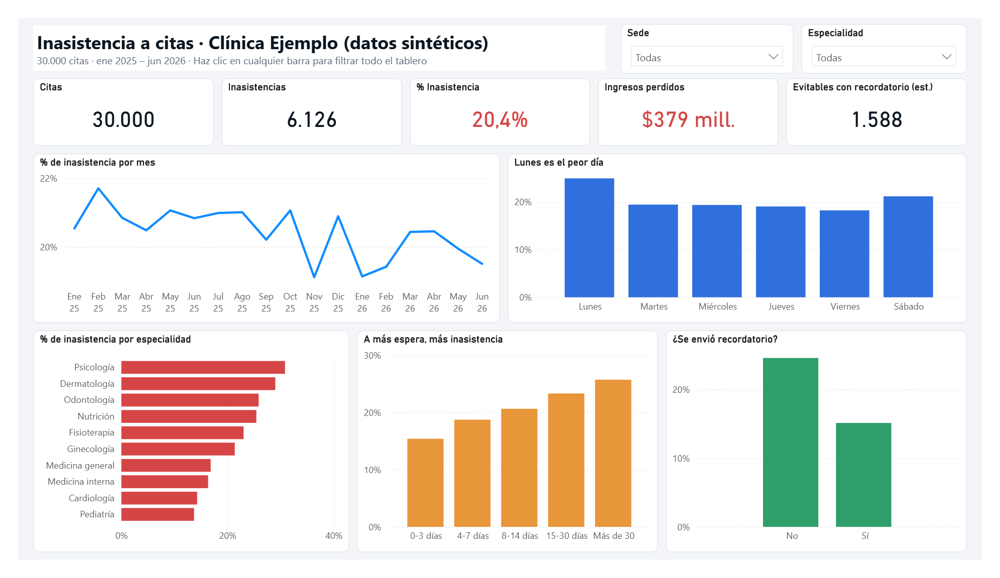
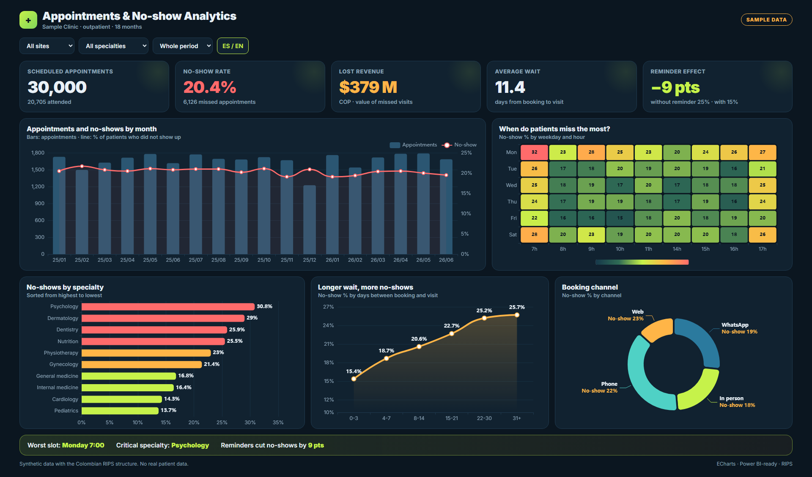
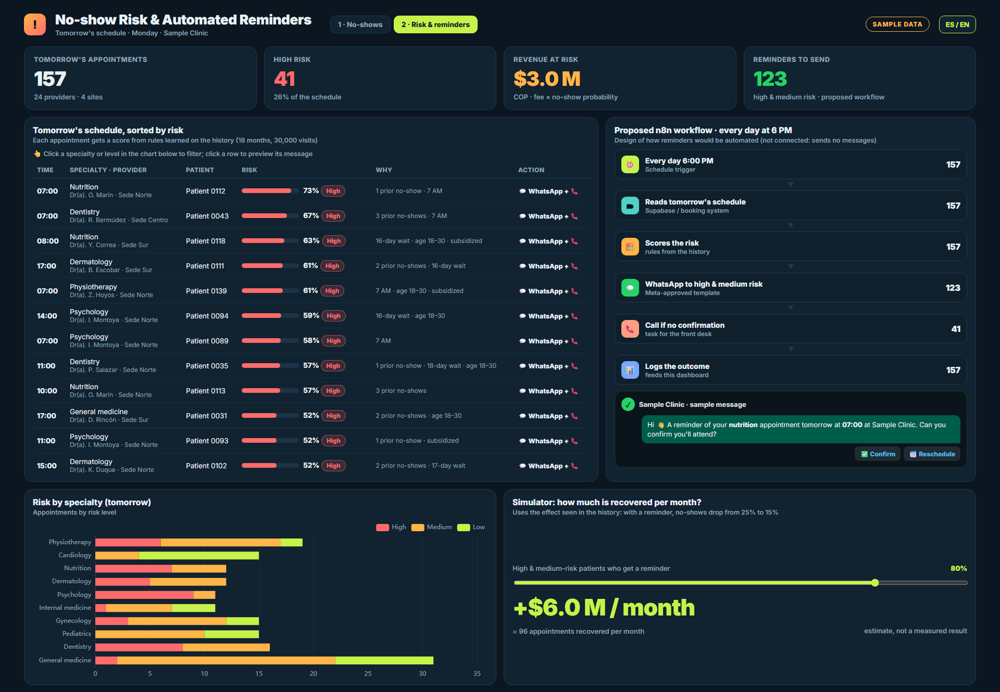

# Clinic No-Show Dashboards — Interactive Web + Power BI

Missed appointments cost clinics money every day. This demo answers two questions with **30,000 synthetic appointments** modeled on the structure of a Colombian outpatient clinic (sites, specialties, insurers, wait times):

1. **Where do no-shows happen?** — Mondays, 7 AM slots, long waits, no reminder.
2. **Which of tomorrow's appointments are at risk, and why?** — ranked list with reasons and a monthly recovery simulator.

> **No real patient data.** Every value is generated by `gen_data.js` with a fixed seed, so the numbers never change between runs.



| Web dashboard 1 — where no-shows happen | Web dashboard 2 — tomorrow's risk |
|---|---|
|  |  |

## Findings in the data

- **20.4%** overall no-show rate
- Monday is the worst day; longer waits mean more no-shows
- Reminders cut no-shows from **25% to 15%**

## What's inside

| File | What it does |
|---|---|
| `gen_data.js` | Generates the synthetic dataset (30k rows, RIPS-like consultation structure) → `data/` |
| `build.js` | Inlines the data + ECharts into two single-file HTML dashboards → `out/` |
| `dashboard-*.tpl.html` | Dashboard templates: KPIs, trend, day × hour heatmap, cross-filtering on click, ES/EN toggle |
| `make_pbip.js` | Writes a **Power BI project (.pbip)** from code: import model, DAX measures (no-show %, lost revenue, avoidable no-shows), slicers |
| `pbi_refresh.ps1` / `pbi_export.ps1` | Refresh and export the report to PDF via Windows UI Automation |
| `pdf2png.js` | Renders the exported PDF to PNG (pdf.js in headless Chrome) |
| `data-sample/` | First 200 rows of the dataset, so you can see the columns without running anything |

## Run it

```bash
npm install
node gen_data.js      # data/citas.csv, data/citas.json, data/manana.json
node build.js         # out/dashboard-agenda.html, out/dashboard-riesgo.html
node make_pbip.js     # pbi/Inasistencia.pbip  (open in Power BI Desktop)
```

## Proposed next step (design only)

An n8n workflow that sends WhatsApp reminders at 6 PM to high-risk patients from dashboard 2. It is a **proposed design**, not connected in this demo.

## Stack

JavaScript (Node.js) · ECharts · Power BI (PBIP, DAX) · PowerShell UI Automation

---

Built by **Luis E. Giraldo** — n8n & AI automation engineer (Digitrion). Available on Upwork.
